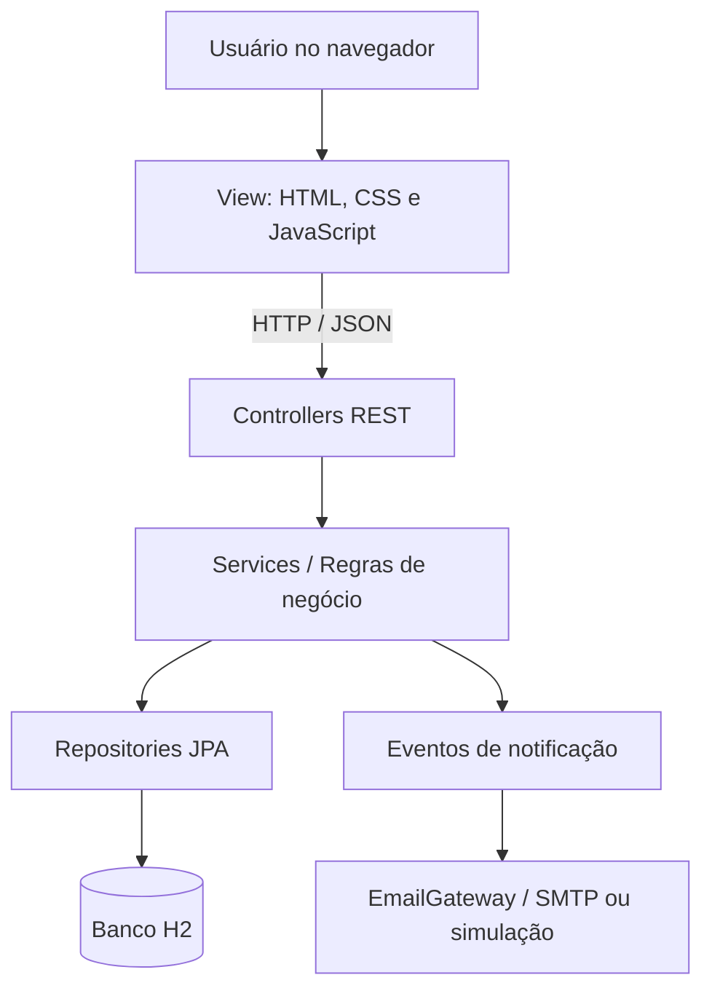

# 🪙 Sistema de Moeda Estudantil

**Projeto acadêmico de Engenharia de Software — PUC Minas**  
**Disciplina:** Laboratório de Desenvolvimento de Software / Projeto de Software  
**Entrega:** Sprint 03 — Protótipo, arquitetura MVC, persistência e demonstração

## 📖 Sobre o projeto

O **Sistema de Moeda Estudantil** é uma aplicação web que incentiva o desempenho e a participação acadêmica por meio de moedas virtuais. Professores recebem uma cota de moedas a cada semestre e podem concedê-las a alunos como reconhecimento por atividades e conquistas. Os alunos acumulam moedas e as utilizam para resgatar vantagens oferecidas por empresas parceiras.

O projeto foi desenvolvido em **Java 21 e Spring Boot 4.1.2**, com interface em **HTML, CSS e JavaScript**, banco **H2** e persistência por **Spring Data JPA / Hibernate**.

> **Escopo:** protótipo acadêmico. As funcionalidades principais foram implementadas e testadas durante o desenvolvimento. O envio de e-mails é **simulado por padrão**; o envio real depende de configuração SMTP. Não se trata de um sistema pronto para produção.

## 🧭 Sumário

- [Objetivos](#-objetivos)
- [Perfis de acesso](#-perfis-de-acesso)
- [Funcionalidades](#-funcionalidades)
- [Tecnologias](#-tecnologias)
- [Arquitetura MVC](#-arquitetura-mvc)
- [Modelo de dados e persistência](#-modelo-de-dados-e-persistência)
- [Como executar](#-como-executar)
- [Configuração de e-mail](#-configuração-de-e-mail)
- [Rotas da API](#-rotas-da-api)
- [Testes](#-testes)
- [Demonstração do fluxo](#-demonstração-do-fluxo)
- [Estrutura do projeto](#-estrutura-do-projeto)
- [Regras de negócio e segurança](#-regras-de-negócio-e-segurança)
- [Limitações e melhorias futuras](#-limitações-e-melhorias-futuras)
- [Entregas acadêmicas](#-entregas-acadêmicas)

## 🎯 Objetivos

- Incentivar o reconhecimento de estudantes por professores.
- Controlar a concessão, a transferência e o uso de moedas estudantis.
- Disponibilizar saldo e extrato das movimentações.
- Permitir que empresas parceiras publiquem vantagens.
- Permitir resgates com desconto de moedas e emissão de cupons.
- Registrar notificações para os participantes das operações.
- Demonstrar o uso do padrão MVC, de ORM e de uma arquitetura web em camadas.

## 👥 Perfis de acesso

| Perfil | Responsabilidades |
| --- | --- |
| **Aluno** | Criar conta, acessar seu cadastro e extrato, receber moedas, consultar vantagens e resgatar benefícios. |
| **Professor** | Acessar conta pré-cadastrada, receber cota semestral, consultar saldo/extrato e enviar moedas a alunos com uma justificativa. |
| **Empresa parceira** | Criar conta, administrar suas vantagens e receber registros/notificações de resgates. |

O cadastro de professores **não é público**. Para testes locais, pode ser habilitado um professor de demonstração.

## ✅ Funcionalidades

### Cadastros e autenticação

- Cadastro, consulta, atualização e exclusão de alunos e empresas parceiras, com autorização por perfil e verificação de propriedade do cadastro.
- Validação dos dígitos verificadores de CPF e CNPJ, incluindo suporte ao CNPJ alfanumérico.
- Verificação de duplicidade de documentos, e-mail e login.
- Senhas armazenadas como **hash BCrypt**.
- Login real por usuário e senha, com **sessão HTTP** e proteção **CSRF**.
- Identificação do perfil autenticado (`ALUNO`, `PROFESSOR` ou `EMPRESA`).
- Pré-cadastro de professor para demonstração local, quando habilitado.

### Moedas e extratos

- Conta individual de moedas para alunos e professores.
- Crédito de **1.000 moedas por professor, por semestre**, sem substituir o saldo remanescente.
- Controle para não duplicar o crédito no mesmo semestre.
- Transferência de moedas **somente de professor para aluno**, com valor positivo e motivo obrigatório.
- Validação de saldo suficiente e registro de débito/crédito relacionados à mesma operação.
- Consulta do saldo e extrato do próprio usuário.
- Registro das operações em transações de banco de dados.

### Vantagens e resgates

- CRUD de vantagens pela empresa responsável, incluindo descrição, imagem por URL HTTPS e custo em moedas.
- Catálogo de vantagens para consulta pelos alunos.
- Bloqueio de alterações/exclusões em vantagens que já possuem resgates.
- Resgate por aluno com saldo suficiente, **desconto das moedas** e **cupom individual**.
- Histórico de cupons do aluno e lançamento de resgate no extrato.

### Notificações

- Registro de notificação ao aluno quando recebe moedas.
- Registro de notificações de resgate para aluno e empresa.
- Processamento de e-mail **após o commit** da transação, por evento.
- **Simulação de envio no terminal**, habilitada por padrão, sem depender de servidor SMTP.

## 🧰 Tecnologias

| Camada / finalidade | Tecnologia |
| --- | --- |
| Linguagem | Java 21 |
| Framework backend | Spring Boot 4.1.2 |
| API REST e MVC | Spring Web MVC |
| Autenticação e autorização | Spring Security |
| Validação de entrada | Jakarta Bean Validation |
| Persistência | Spring Data JPA e Hibernate |
| Banco de desenvolvimento | H2, em arquivo local |
| Interface | HTML5, CSS3 e JavaScript (Fetch API) |
| Agendamento | Spring Scheduling |
| Notificações por e-mail | Spring Mail / JavaMailSender |
| Testes | JUnit 5, Spring Boot Test, MockMvc e Mockito |
| Dependências e build | Maven |
| Desenvolvimento | Visual Studio Code |

## 🏗️ Arquitetura MVC

A aplicação combina **MVC** com uma separação interna em camadas:

- **View:** páginas estáticas, estilos e JavaScript que interagem com a API via `fetch`.
- **Controller:** endpoints REST, validação de entrada e tratamento das solicitações HTTP.
- **Service:** regras de negócio, autorização vinculada ao usuário, transações, créditos, transferências e resgates.
- **Repository:** acesso a dados com Spring Data JPA.
- **Entity / Model:** representação das entidades de domínio e dos relacionamentos JPA.
- **Infraestrutura:** configurações de segurança, agendamento do crédito semestral e integração de e-mail.



### Exemplo: transferência de moedas

1. O professor autenticado informa o aluno, a quantidade e o motivo.
2. O Controller valida a solicitação e chama o Service.
3. O Service identifica o professor, verifica o aluno e bloqueia as contas envolvidas.
4. O saldo do professor é reduzido e o do aluno é aumentado dentro da **mesma transação**.
5. O sistema grava as movimentações e registra a notificação.
6. Após a confirmação no banco, é processada a tentativa de envio do e-mail.

## 🗃️ Modelo de dados e persistência

Principais entidades:

| Entidade | Papel |
| --- | --- |
| `Usuario` | Dados comuns de identificação e autenticação. |
| `Aluno`, `Professor`, `EmpresaParceira` | Perfis especializados de usuário. |
| `Instituicao` | Instituição de ensino vinculada aos alunos e professores. |
| `Conta` | Saldo de moedas e controle de versão. |
| `Transacao` | Movimentações de crédito, envio, recebimento e resgate. |
| `Vantagem` | Benefício e custo em moedas, vinculados à empresa. |
| `Resgate` | Vantagem resgatada pelo aluno, data e código do cupom. |
| `Notificacao` | Mensagens relacionadas a recebimentos e resgates. |

A herança entre `Usuario` e seus perfis é mapeada com JPA (`JOINED`). O H2 é persistido em arquivo durante a execução normal e é substituído por um banco em memória durante os testes automatizados.

**Integridade:** operações financeiras utilizam `@Transactional`; as contas usam bloqueio pessimista nas alterações de saldo. O crédito semestral possui identificação de período para evitar duplicidade. O sistema também registra um identificador comum para os dois lançamentos de cada transferência.

> Não apague a pasta `data/` se desejar preservar os registros criados localmente. Arquivos do banco não devem ser versionados no Git.

## 🚀 Como executar

### Pré-requisitos

- **JDK 21** instalado ou configurado no VS Code.
- **Maven** para execução pelo terminal, ou as extensões Java/Maven do VS Code.
- Navegador atualizado.

> Execute os comandos **na pasta que contém o `pom.xml`** (`moeda-estudantil-starter`, se você manteve a estrutura inicial).

### Pelo terminal

```bash
mvn clean test
mvn spring-boot:run
```

Depois acesse:

**http://localhost:8080**

A aplicação usa a porta `8080` por padrão e cria/atualiza o banco em `./data/moeda-estudantil`, relativo ao diretório de execução.

### Pelo Visual Studio Code (sem Maven global)

1. Abra o projeto e localize a pasta que contém `pom.xml`.
2. Certifique-se de que as extensões **Extension Pack for Java** e **Test Runner for Java** estejam instaladas.
3. Acesse **Executar e Depurar** (`Ctrl + Shift + D`).
4. Selecione a configuração **Moeda Estudantil** e inicie a aplicação.
5. Abra **http://localhost:8080**.

Se o workspace do VS Code estiver aberto **um nível acima** do projeto Maven, o diretório de execução (`cwd`) deve apontar para `moeda-estudantil-starter`.

### Professor de demonstração

Para criar um professor fictício no ambiente local, configure estas variáveis de ambiente **antes de iniciar a aplicação**:

```properties
APP_PROFESSOR_DEMO_ENABLED=true
APP_PROFESSOR_DEMO_SENHA=<defina-uma-senha-de-desenvolvimento-com-8-ou-mais-caracteres>
```

- **Login gerado:** `professordemo`.
- **Senha:** a que foi definida em `APP_PROFESSOR_DEMO_SENHA` na primeira criação.
- O cadastro é idempotente: não recria o professor a cada reinicialização.
- Alterar a variável após a criação **não troca** a senha já armazenada no banco.

**Não publique senhas no repositório.** O `.vscode/launch.json` local pode ser usado para fornecer as variáveis, mas deve permanecer ignorado pelo Git. O professor de demonstração não deve ser habilitado em produção.

### Banco H2

As configurações principais ficam em `src/main/resources/application.properties`:

```properties
spring.datasource.url=${SPRING_DATASOURCE_URL:jdbc:h2:file:./data/moeda-estudantil;DB_CLOSE_ON_EXIT=FALSE}
spring.jpa.hibernate.ddl-auto=update
spring.jpa.open-in-view=false
```

Para execução normal, utilize banco em arquivo. Os testes configuram H2 em memória e não devem modificar os cadastros da aplicação.

## ✉️ Configuração de e-mail

O modo padrão é **simulado**:

```properties
app.email.enabled=false
```

Nesse modo, a aplicação escreve mensagens identificadas por `[EMAIL SIMULADO]` no log, sem enviar mensagens reais.

Para usar SMTP, defina `app.email.enabled=true`, um remetente e as propriedades Spring Mail para o seu provedor. Exemplo **somente ilustrativo**:

```properties
app.email.enabled=true
app.email.from=${MAIL_FROM}
spring.mail.host=${MAIL_HOST}
spring.mail.port=${MAIL_PORT}
spring.mail.username=${MAIL_USERNAME}
spring.mail.password=${MAIL_PASSWORD}
spring.mail.properties.mail.smtp.auth=true
spring.mail.properties.mail.smtp.starttls.enable=true
```

Os valores reais dependem do serviço contratado. **Nunca envie credenciais reais ao GitHub.**

O processamento de eventos após a transação evita que um erro de e-mail reverta um crédito ou resgate já confirmado. Porém, o protótipo **não implementa fila persistente nem tentativas automáticas de reenvio**.

## 🌐 Rotas da API

A API usa o prefixo `/api`. Rotas protegidas exigem uma sessão autenticada. Operações de escrita feitas pela interface também enviam o token CSRF.

### Autenticação e cadastros

| Método | Rota | Acesso / operação |
| --- | --- | --- |
| `GET` | `/api/auth/csrf` | Preparar token CSRF. |
| `POST` | `/api/auth/login` | Login por formulário (`login` e `senha`). |
| `POST` | `/api/auth/logout` | Encerrar sessão. |
| `GET` | `/api/auth/me` | Consultar dados e perfil do usuário autenticado. |
| `GET` | `/api/instituicoes` | Consultar instituições. |
| `POST` | `/api/alunos` | Cadastro público de aluno. |
| `GET` | `/api/alunos` e `/api/alunos/{id}` | Consultar cadastro de aluno conforme autorização. |
| `PUT` / `DELETE` | `/api/alunos/{id}` | Alterar/excluir o próprio cadastro de aluno. |
| `POST` | `/api/empresas` | Cadastro público de empresa parceira. |
| `GET` | `/api/empresas` e `/api/empresas/{id}` | Consultar cadastro conforme autorização. |
| `PUT` / `DELETE` | `/api/empresas/{id}` | Alterar/excluir o próprio cadastro de empresa. |

### Moedas e extratos

| Método | Rota | Acesso / operação |
| --- | --- | --- |
| `GET` | `/api/extratos/me` | Aluno ou professor: próprio saldo e extrato. |
| `GET` | `/api/moedas/alunos` | Professor: listar alunos disponíveis para transferência. |
| `POST` | `/api/moedas/enviar` | Professor: transferir moedas com justificativa. |

Exemplo de corpo para `POST /api/moedas/enviar`:

```json
{
  "alunoId": 1,
  "quantidade": 150,
  "motivo": "Excelente participação em aula"
}
```

### Vantagens e resgates

| Método | Rota | Acesso / operação |
| --- | --- | --- |
| `GET` | `/api/vantagens` | Aluno ou empresa: consultar catálogo. |
| `GET` | `/api/vantagens/{id}` | Aluno ou empresa: consultar vantagem. |
| `GET` | `/api/vantagens/minhas` | Empresa: listar próprias vantagens. |
| `POST` | `/api/vantagens` | Empresa: cadastrar vantagem. |
| `PUT` / `DELETE` | `/api/vantagens/{id}` | Empresa: administrar uma vantagem própria. |
| `POST` | `/api/resgates` | Aluno: resgatar uma vantagem. |
| `GET` | `/api/resgates/me` | Aluno: consultar seus cupons. |

Exemplo de cadastro de vantagem:

```json
{
  "descricao": "Combo café e pão de queijo",
  "foto": "https://exemplo.com/imagem.jpg",
  "custoMoedas": 100
}
```

Exemplo de solicitação de resgate:

```json
{
  "vantagemId": 1
}
```

> Os identificadores `1` dos exemplos são ilustrativos. Use os IDs existentes no banco. Para chamadas HTTP fora da interface, também é necessário lidar com a sessão e o CSRF.

## 🧪 Testes

Os testes foram criados com **JUnit 5**, **MockMvc**, **Mockito** e H2 em memória, incluindo cenários de sucesso, validação e autorização.

| Classe de teste | Escopo |
| --- | --- |
| `DocumentoValidatorTest` | CPF numérico e CNPJ numérico/alfanumérico; documentos inválidos. |
| `MoedaEstudantilApplicationTests` | Inicialização do contexto Spring. |
| `CadastroIntegracaoTest` | CRUDs, login, senha inválida, CSRF, perfis e acesso a outros cadastros. |
| `MoedaServiceTest` | Crédito semestral, ausência de duplicação, transferência e extratos. |
| `NotificacaoServiceTest` | Persistência da notificação e publicação do evento. |
| `VantagemIntegracaoTest` | CRUD de vantagens, propriedade, permissões e custo inválido. |
| `ResgateIntegracaoTest` | Resgate, saldo insuficiente, autorização e consulta de cupons. |

### Executando

Pelo terminal, na pasta do `pom.xml`:

```bash
mvn test
```

Ou, no VS Code, abra a classe de teste e clique em **Run Test** ou use o painel **Testing**.

**Importante:** os testes foram validando funcionalidades ao longo do desenvolvimento. Antes da entrega, execute **toda a suíte de uma vez** e registre o resultado final. Testes automatizados com rollback não confirmam o envio efetivo de e-mails; essa parte deve ser conferida com uma operação real no navegador e, se SMTP estiver ativo, com o serviço de e-mail.

## 🎬 Demonstração do fluxo

Roteiro sugerido para demonstrar o protótipo:

1. **Empresa parceira:** fazer login e cadastrar uma vantagem de **100 moedas**.
2. **Professor:** fazer login, verificar o crédito semestral e transferir **150 moedas** para um aluno, informando o motivo.
3. **Aluno:** fazer login e consultar o extrato com o recebimento de **150 moedas**.
4. **Aluno:** abrir o catálogo e resgatar a vantagem de **100 moedas**.
5. **Aluno:** verificar o novo saldo de **50 moedas**, o lançamento no extrato e o cupom gerado.
6. **Terminal:** conferir os e-mails simulados relativos à transferência e ao resgate.
7. **Persistência:** reiniciar a aplicação e confirmar que saldos, movimentações e cupons permanecem registrados.

> Os saldos do roteiro pressupõem contas sem movimentações anteriores. Em um banco já utilizado, considere os saldos reais e confira a variação exata de cada operação.

## 📁 Estrutura do projeto

```text
moeda-estudantil-starter/
├── pom.xml
├── README.md
├── Diagramas/
├── data/                         # Banco H2 local (não versionar)
└── src/
    ├── main/
    │   ├── java/br/edu/pucminas/moedaestudantil/
    │   │   ├── config/           # Segurança e dados de demonstração
    │   │   ├── controller/       # Endpoints REST
    │   │   ├── dto/
    │   │   │   ├── request/      # Entrada e validação
    │   │   │   └── response/     # Respostas da API
    │   │   ├── exception/        # Tratamento de erros
    │   │   ├── infrastructure/
    │   │   │   ├── email/        # Gateway, eventos e listeners
    │   │   │   └── scheduling/   # Crédito semestral agendado
    │   │   └── model/
    │   │       ├── entity/       # Entidades JPA
    │   │       ├── enums/        # Tipos de transação/notificação
    │   │       ├── repository/   # Spring Data JPA
    │   │       ├── service/      # Regras de negócio
    │   │       └── validation/   # Validação de documentos
    │   └── resources/
    │       ├── application.properties
    │       └── static/
    │           ├── index.html
    │           ├── css/style.css
    │           └── js/app.js
    └── test/java/br/edu/pucminas/moedaestudantil/
        └── ...                  # Testes unitários e de integração
```

## 🔒 Regras de negócio e segurança

- O usuário acessa apenas as operações autorizadas ao seu **perfil**.
- Alunos e empresas podem modificar apenas seus próprios cadastros.
- Somente o professor pode transferir moedas; somente o aluno pode resgatar vantagens.
- Moedas não podem ser transferidas em quantidade zero ou negativa nem acima do saldo disponível.
- O resgate exige saldo suficiente e registra um débito no extrato.
- O crédito semestral do professor é **cumulativo** e não deve ser concedido duas vezes no mesmo período.
- Uma empresa não pode editar ou excluir vantagens de outra empresa.
- Vantagens com resgates registrados têm alteração e exclusão bloqueadas.
- Senhas são armazenadas como hash BCrypt; a interface usa sessão HTTP e CSRF.
- O envio de e-mail ocorre após a confirmação no banco, sem integrar a transação financeira.

**Atenção aos dados locais:** evite versionar `.env`, `.vscode/launch.json`, `data/*.mv.db`, `data/*.trace.db` e quaisquer arquivos com credenciais ou dados reais de usuários.

## 🔭 Limitações e melhorias futuras

Este é um **protótipo acadêmico**, não uma implantação de produção. Pontos para evolução:

- Configuração e verificação de entrega de **SMTP real**.
- Fila persistente, registro de falhas e **reenvio de notificações**.
- Tela e endpoint para a empresa **conferir/validar o cupom** e marcar seu uso.
- Testes adicionais de **concorrência**, tentativas simultâneas de resgate e comportamento sob falhas.
- Revisão da exclusão de usuários com contas, transações e resgates associados; preferência por desativação lógica quando houver histórico.
- Controle de tentativas de login, recuperação de senha e gestão institucional dos professores.
- Migrações versionadas do banco, observabilidade e implantação com banco adequado para múltiplos usuários.
- Upload seguro e armazenamento de imagens, em vez de apenas links externos.

## 🎓 Entregas acadêmicas

O desenvolvimento foi organizado em três sprints:

| Sprint | Entregas abordadas |
| --- | --- |
| **Sprint 01** | Levantamento de casos de uso, histórias de usuário, diagrama de classes e diagrama de componentes. |
| **Sprint 02** | Modelo entidade-relacionamento, escolha do ORM/DAO, estrutura MVC, banco e CRUD inicial de alunos e empresas. |
| **Sprint 03** | Integração do protótipo, autenticação, moedas, vantagens, resgates, testes, documentação e demonstração da arquitetura/persistência. |

Os diagramas devem ser mantidos atualizados na pasta `Diagramas/` e coerentes com a implementação final. A apresentação da Sprint 03 deve explicar a arquitetura, as tecnologias utilizadas, a persistência e demonstrar o sistema em funcionamento.

---

**Projeto acadêmico desenvolvido para fins educacionais.**
